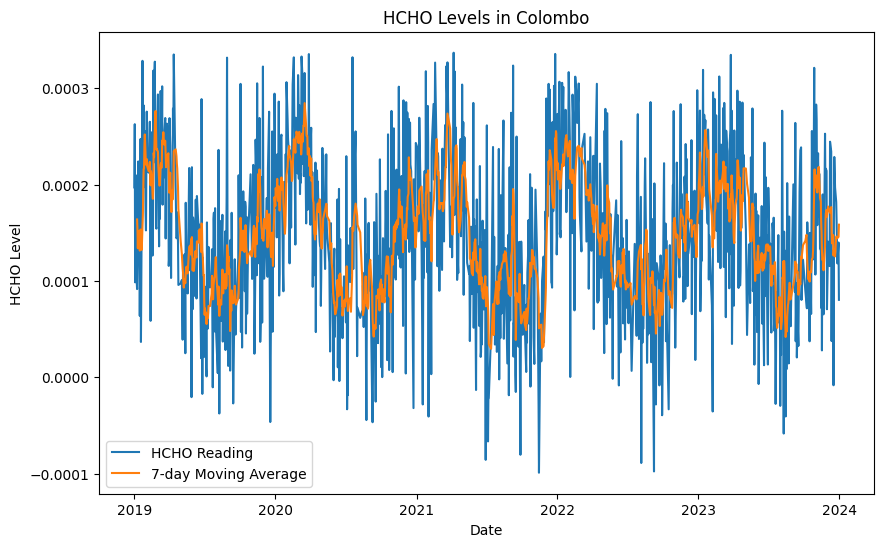
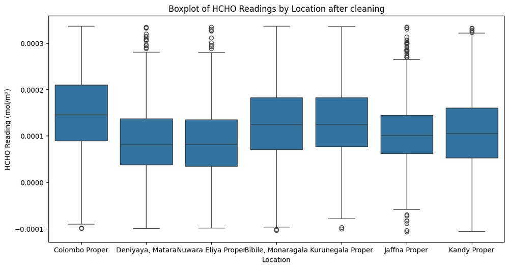
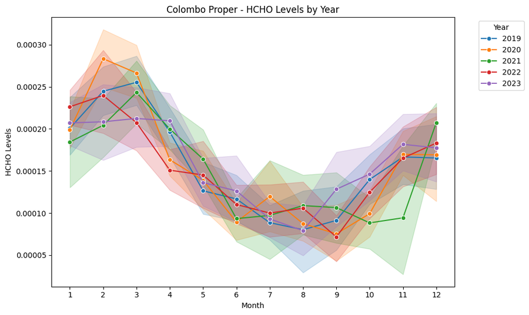
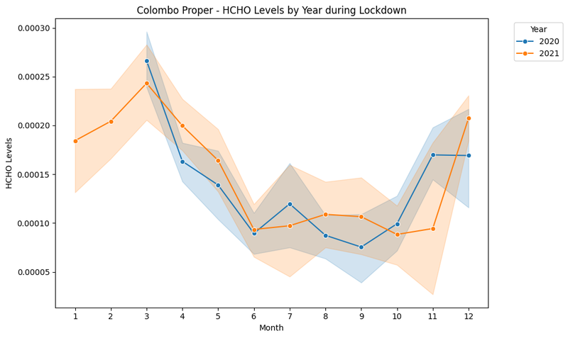
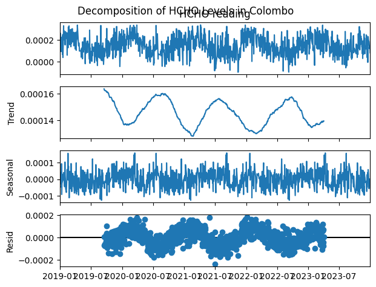
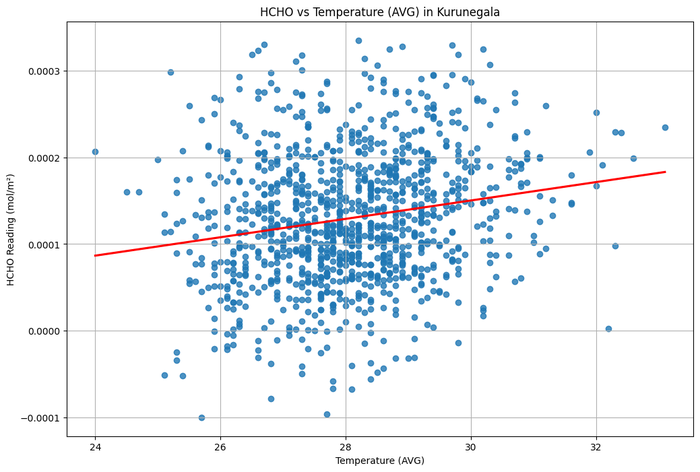
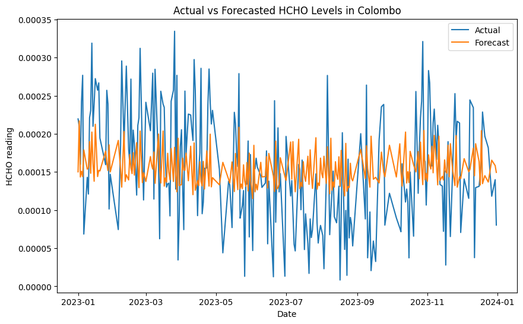

<div align="center">

# 🌍 Formaldehyde (HCHO) Air-Quality Analysis Across Sri Lanka

**Data Engineering coursework (CM2606): cleaning, spatio-temporal analysis and forecasting of satellite HCHO readings for seven Sri Lankan locations, 2019–2023.**




</div>

---

## 📌 Overview

Formaldehyde (HCHO) is an air pollutant linked to combustion, traffic and industry. This project takes daily **satellite HCHO column readings (mol/m²)** for seven locations and asks:

- How do HCHO levels **differ between cities** and change **year to year**?
- Is there a **seasonal (monthly) pattern**?
- What happened during the **COVID-19 lockdown period** (March 2020 – December 2021)?
- How do **weather** (temperature, precipitation) and **population density / altitude** relate to HCHO?
- Can we **forecast** HCHO for Colombo?

**Locations:** Colombo · Kandy · Kurunegala · Jaffna · Nuwara Eliya · Deniyaya (Matara) · Bibile (Monaragala)

## 🧹 Data engineering

- Merged multi-city HCHO CSVs into one dataset (12,782 rows)
- Normalised location names and converted date columns
- Removed missing readings and **IQR outliers**, leaving 7,703 clean rows
- Cleaned and joined **daily weather station data** (precipitation, average / min / max temperature) for Colombo, Kurunegala and Nuwara Eliya
- Added yearly **population, population density and altitude** per city

<p align="center">
  
  <br/><sub>Colombo has the highest median HCHO of the seven locations; Nuwara Eliya and Deniyaya have the lowest.</sub>
</p>

## 📊 Spatio-temporal analysis

<p align="center">
  
  
  <br/><sub>Left: Colombo shows a clear seasonal cycle, peaking around February–March and dipping mid-year. Right: the same months during the 2020–2021 lockdown period.</sub>
</p>

<p align="center">
  
  
  <br/><sub>Seasonal decomposition of Colombo HCHO, and the HCHO–temperature relationship in Kurunegala</sub>
</p>

## 🔮 Forecasting

A **SARIMAX(2,0,2)(1,1,1,12)** model forecasts Colombo HCHO. It uses precipitation, average temperature, population, population density and altitude as exogenous variables, an 80/20 chronological split and an expanding training window.

| MAE | RMSE |
|:-:|:-:|
| 6.26 × 10⁻⁵ mol/m² | 7.48 × 10⁻⁵ mol/m² |

<p align="center"></p>

## 📂 Notebooks

| Notebook | Description |
|---|---|
| `DECWNEW4.ipynb` | **Final version:** cleaning, spatio-temporal analysis, weather & demographic factors, SARIMAX forecasting |
| `DECWNEW2.ipynb` | Earlier full iteration of the analysis |
| `DECW1.ipynb`, `DECW2.ipynb` | Initial exploration and cleaning experiments |
| `FlightUpdated.ipynb`, `Regression1.ipynb` | Separate flight-booking fare analysis experiments (see the RND repo) |

## 🚀 Running

```bash
pip install pandas numpy matplotlib seaborn statsmodels scikit-learn
```

The notebooks were written for **Google Colab** and read CSVs from Google Drive. Update the `read_csv` paths to point at your copies of the HCHO and weather files.

---

<div align="center"><sub>Built by <a href="https://github.com/minudakaliyanage">Minudaka Liyanage</a></sub></div>
